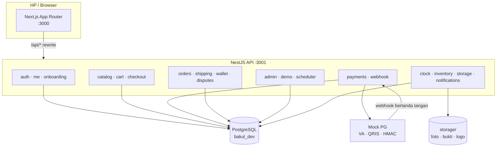
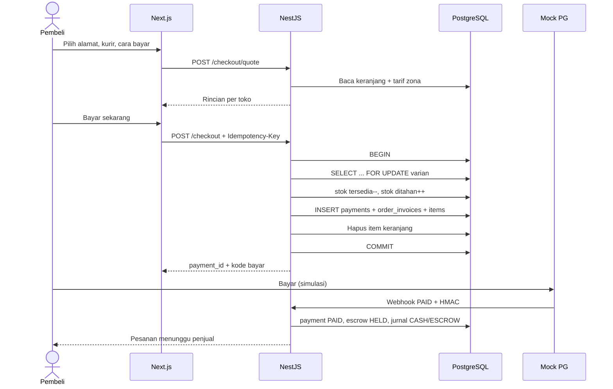
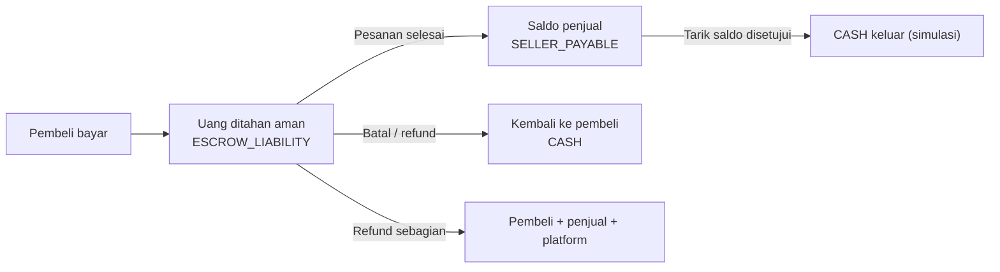

# Arsitektur Bakul

Dokumen ini menjelaskan bentuk sistem yang sudah berjalan. Sumber kebenaran
produk tetap `docs/prd/bakul-v0.2.md`.

## 1. Gambaran besar



Satu origin: browser hanya memanggil `/api/*` di port 3000. Next.js me-rewrite
ke API port 3001, jadi tidak ada CORS dan cookie refresh tetap same-origin.

## 2. Modul API

| Modul | Tanggung jawab |
| :--- | :--- |
| `auth` | OTP nomor HP, access JWT 15 menit, refresh cookie 7 hari, rotasi sesi |
| `me` | Profil dan alamat pengiriman |
| `onboarding` | Buka toko dan produk pertama |
| `catalog` | Kategori, pencarian/filter, detail barang, halaman toko |
| `cart` | Keranjang per pengguna, kelompok per toko, pilih item |
| `checkout` | Quote ongkir, kunci stok, buat 1 payment + N invoice |
| `payments` | Tagihan mock, instruksi VA/QRIS, webhook HMAC, kedaluwarsa |
| `ledger` | Jurnal double-entry, saldo penjual, invariant |
| `orders` | Daftar/detail pesanan, konfirmasi terima, ulasan, lifecycle |
| `shipping` | Tarif zona, AWB deterministik, label PDF, pelacakan publik |
| `seller` | Profil toko, etalase, produk, pesanan masuk, label, dompet |
| `wallet` | Saldo toko, mutasi, pengajuan tarik saldo, bukti transfer |
| `disputes` | Komplain, diskusi, eskalasi, keputusan admin |
| `admin` | Metrik, moderasi toko/barang, antrean pencairan |
| `demo` | Time machine, simulator pembayaran, reset data demo |
| `notifications` | Inbox bergaya WhatsApp untuk semua perubahan status |
| `scheduler` | SLA, kedaluwarsa, pergerakan resi, auto-complete |

## 3. Alur checkout



Jika stok berubah, transaksi di-rollback dan API mengembalikan `409` dengan nama
barang yang kurang. Tidak ada tagihan setengah jadi.

## 4. Siklus uang



Setiap panah adalah satu jurnal yang seimbang. Tidak ada perubahan saldo tanpa
baris ledger. `npm run ledger:check` memeriksa:

1. debit = kredit per jurnal;
2. saldo dompet = saldo akun `SELLER_PAYABLE:{shop}`;
3. saldo escrow ledger = total invoice `HELD`/`FROZEN`;
4. tidak ada nominal nol/negatif;
5. trigger append-only menolak update/delete.

## 5. Waktu dan scheduler

- `ClockService` adalah satu-satunya sumber waktu domain.
- Mode demo menyimpan epoch, waktu mulai, dan kecepatan di `app_settings`.
- Scheduler in-process berjalan setiap 5 detik dan menangani:
  - tagihan kedaluwarsa → pesanan batal, stok kembali;
  - penjual lewat 48 jam → batal otomatis + refund;
  - resi bergerak sesuai timeline 32 jam;
  - pesanan tiba lewat 72 jam → selesai otomatis + escrow dilepas.
- Demo Console dapat memajukan waktu tanpa menunggu.

## 6. Adapter dan mock

| Kontrak | Implementasi sekarang | Pengganti masa depan |
| :--- | :--- | :--- |
| `PaymentProvider` | `MockPgService` | Midtrans / Xendit |
| `LogisticsProvider` | `ShippingService` (mock zona) | Biteship / KiriminAja |
| `Notifier` | In-app `notifications` | Fonnte / Resend |
| `StorageAdapter` | folder `storage/` | S3 / R2 |

Kontrak TypeScript ada di `packages/shared/src/contracts.ts`. Memilih implementasi
dilakukan lewat env (`PAYMENT_PROVIDER=mock`, dan seterusnya).

## 7. Struktur folder

```text
apps/api/src/
  auth/ me/ onboarding/ catalog/ cart/ checkout/
  payments/ ledger/ orders/ shipping/ seller/ wallet/
  disputes/ admin/ demo/ scheduler/ notifications/
  common/{auth,clock,inventory,storage,http,pipes,filters}
apps/api/prisma/
  schema.prisma  migrations/  seed.ts  seed-history.ts
apps/web/app/
  (pembeli) / /cari /p/[slug] /toko/[slug] /keranjang /bayar
  /pembayaran/[id] /pesanan /lacak/[awb]
  /jualan /jualan/barang /jualan/pesanan /jualan/dompet /jualan/toko
  /admin /admin/komplain /admin/pencairan /admin/toko /dev
packages/shared/src/
  commerce.ts orders.ts finance.ts admin.ts demo.ts contracts.ts
docs/
  prd/ desain/ adr/ bukti/
```

## 8. Batasan yang disengaja

- Satu instance, satu PostgreSQL, tanpa Redis/queue.
- Pencarian masih menyaring di database lalu mengurutkan di memori untuk 100
  produk; batasnya dicatat di ADR 0005.
- Chat hanya di ruang komplain.
- Tidak ada promo, COD, email wajib, dark mode, atau animasi berat.
- Semua uang adalah simulasi, tetapi stok, state machine, dan ledger berperilaku
  seperti produksi.
