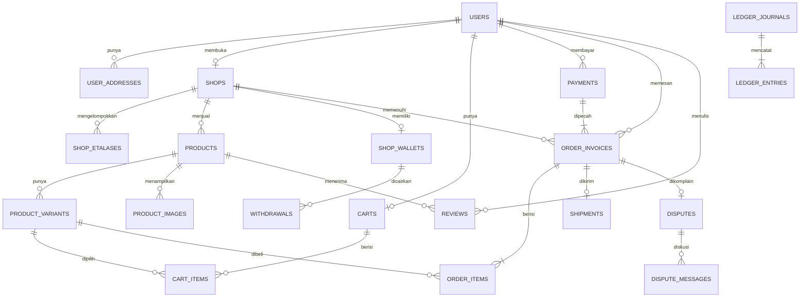

# Model Data Bakul

Database: PostgreSQL lokal `bakul_dev`. Sumber kebenaran: `apps/api/prisma/schema.prisma`.
Semua uang disimpan sebagai integer rupiah. Waktu domain memakai `ClockService`.

## 1. Relasi utama



## 2. Tabel

| Tabel | Isi | Aturan penting |
| :--- | :--- | :--- |
| `users` | Akun pembeli, penjual, admin, operator | `phone` unik; `email` opsional; peran dibaca ulang setiap request |
| `user_addresses` | Alamat pengiriman | Maksimal satu default per pengguna (unique index parsial) |
| `shops` | Toko | `slug` unik; `logo_url`, bank, kurir aktif; status `ACTIVE`/`SUSPENDED` |
| `shop_etalases` | Kelompok barang di toko | `(shop_id, slug)` unik; hapus etalase tidak menghapus barang |
| `products` | Barang | Soft delete lewat `status`; `avg_rating`, `sold_count` cache |
| `product_variants` | Pilihan barang | `stock_available >= 0`, `stock_reserved >= 0`; SKU unik |
| `product_images` | Foto barang | WebP target ≤32 KB; maksimal 5 per barang |
| `reviews` | Ulasan pembeli | Rating 1–5; satu ulasan per `order_item_id`; foto di `media_urls` |
| `carts` | Keranjang pengguna | Satu keranjang per pengguna |
| `cart_items` | Item keranjang | `(cart_id, variant_id)` unik; jumlah > 0 |
| `payments` | Satu tagihan | `idempotency_key`, `payment_code`, `provider_ref` unik |
| `order_invoices` | Satu pesanan per toko | `invoice_number` unik; snapshot alamat, kurir, biaya |
| `order_items` | Snapshot barang | Nama, pilihan, harga, berat, foto dibekukan saat checkout |
| `shipments` | Resi dan tracking | Satu per invoice; `awb` unik; riwayat JSONB |
| `disputes` | Komplain | Satu dispute per invoice; bukti dan keputusan |
| `dispute_messages` | Ruang diskusi | Pengirim, peran, isi |
| `shop_wallets` | Saldo toko (cache) | `balance_available`, `balance_withheld`; sumber kebenaran ledger |
| `withdrawals` | Pengajuan tarik saldo | `idempotency_key` unik; minimum Rp50.000 |
| `ledger_journals` | Satu kejadian ekonomi | `ref_type` + `ref_id` |
| `ledger_entries` | Baris debit/kredit | Append-only; nominal > 0; trigger menolak update/delete |
| `webhook_events` | Log webhook mock | `event_id` unik; status RECEIVED/PROCESSED/IGNORED |
| `app_settings` | Jam demo dan konfigurasi | `demo_epoch`, `demo_started_at`, `demo_speed` |
| `notifications` | Inbox in-app | Template dan payload JSON |
| `otp_codes` | Kode masuk | Hash, percobaan, kedaluwarsa |
| `sessions` | Refresh token | Hash unik; rotasi setiap refresh |

## 3. Mengapa snapshot?

Harga barang bisa berubah setelah pembeli membayar. Karena itu `order_items`
menyimpan `name_snapshot`, `variant_snapshot`, `price_snapshot`,
`weight_snapshot`, dan `image_url`. Riwayat pesanan tidak ikut berubah ketika
penjual mengubah barang.

Alamat juga disalin ke invoice (`recipient_name`, `phone`, `full_address`,
`city_name`), sehingga perubahan alamat pengguna tidak mengubah label lama.

## 4. Uang dan escrow

Formula yang dijaga:

```text
total invoice   = subtotal + ongkir + biaya layanan
biaya layanan   = 1.000 + 0,7% × (subtotal + ongkir)
komisi platform = 2% × subtotal
hak penjual     = subtotal + ongkir - komisi platform
```

`order_invoices` menyimpan `total_amount`, `platform_fee`, `net_seller_amount`,
dan status escrow. `payments.total_amount` harus sama dengan jumlah seluruh
invoice di bawahnya. Ini diperiksa oleh `verify:m3`.

Status escrow: `PENDING`, `HELD`, `FROZEN`, `RELEASED`, `REFUNDED`,
`PARTIALLY_REFUNDED`, `CANCELLED`.

## 5. Stok

- Checkout: `stock_available -= qty`, `stock_reserved += qty`.
- Selesai: `stock_reserved -= qty` (barang terjual).
- Batal/refund dengan barang kembali: `stock_available += qty`,
  `stock_reserved -= qty`.
- Check constraint mencegah stok negatif.

Kunci baris memakai `SELECT ... FOR UPDATE` dengan urutan `id` agar tidak
deadlock. Uji T-02 menjalankan 100 checkout paralel pada stok 1.

## 6. Ledger dan dompet

Akun standar:

- `CASH`
- `ESCROW_LIABILITY`
- `PLATFORM_REVENUE`
- `PG_FEE_EXPENSE`
- `SELLER_PAYABLE:{shop_id}`

Saldo dompet = kredit - debit pada akun penjual. Saat pengajuan tarik saldo,
saldo pindah dari `balance_available` ke `balance_withheld`; ledger belum
berubah. Saat admin menyetujui, baris `WITHDRAWAL` mendebit utang penjual dan
mengkredit kas. Saat ditolak, saldo kembali ke `balance_available`.

## 7. Indeks penting

- `payments(status, expires_at)` untuk scheduler kedaluwarsa.
- `order_invoices(order_status, seller_confirm_deadline)` untuk SLA penjual.
- `order_invoices(shop_id, order_status)` untuk daftar pesanan toko.
- `ledger_entries(journal_id)`, `(account_code)`, `(shop_id)` untuk pemeriksaan.
- `webhook_events(event_id)` unik untuk idempotensi.
- `user_addresses(user_id) WHERE is_default` unik untuk satu alamat utama.

## 8. Batasan yang diketahui

- Belum ada tabel `shipping_zones`; tarif mock dihitung dari lima kota seed.
- Ulasan hanya satu per item pesanan; belum ada moderasi ulasan.
- `order_items` menyimpan `product_id`/`variant_id` yang bisa menjadi `NULL`
  bila barang dihapus permanen, tetapi snapshot tetap utuh.
- Retur memakai status dan keputusan admin; belum ada AWB balik otomatis.
