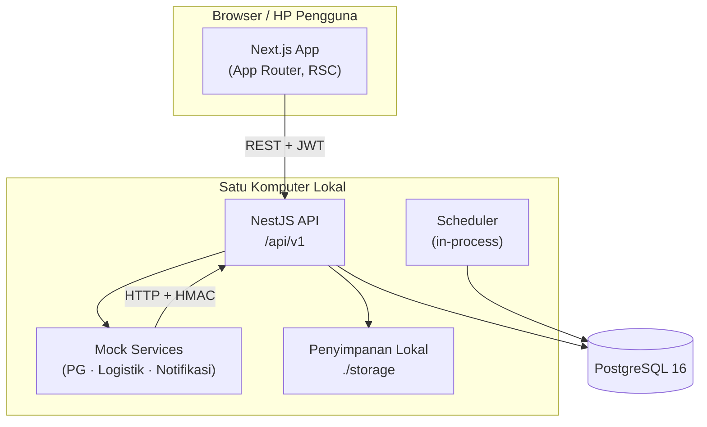
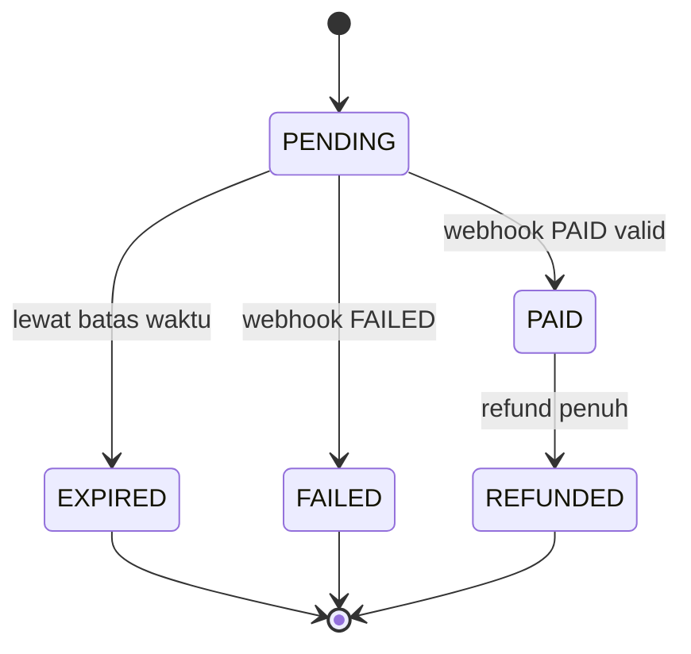
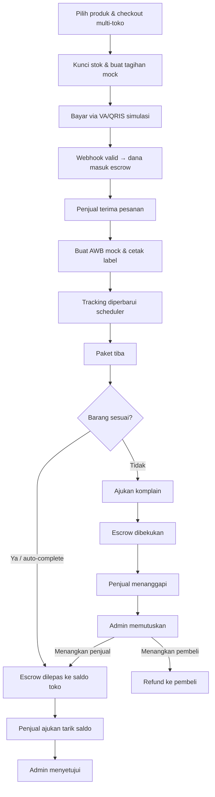
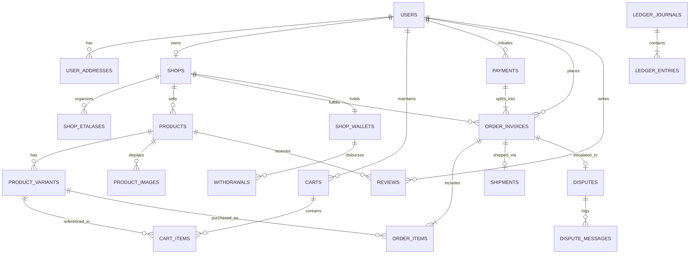
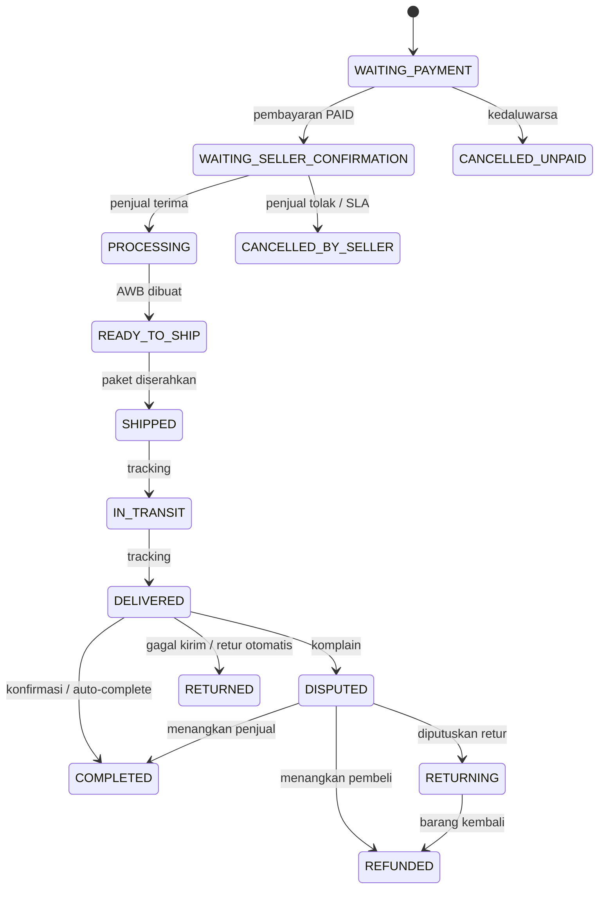

# PRODUCT REQUIREMENTS DOCUMENT (PRD)

## Informasi Dokumen

| Atribut | Detail |
| :--- | :--- |
| **Nama Produk** | **Bakul** — Pasar Daring untuk Pedagang Kecil |
| **Tagline** | *Jualan dari lapak, sampai ke seluruh negeri.* |
| **Status Dokumen** | Final Draft — Disetujui untuk Implementasi |
| **Versi Dokumen** | v0.2 |
| **Menggantikan** | v0.1 (Draft Sementara, nama produk: TeknoLoka) |
| **Nama Sebelumnya** | TeknoLoka — diganti pada v0.2 karena terlalu teknis dan jauh dari bahasa pedagang |
| **Tim Pengembang** | Tim Teknis (Principal System Analyst, Technical Product Manager, Software Architect) |
| **Nama Klien** | Founder & Pemilik Bisnis (Product Owner) |
| **Tanggal Penyusunan** | 2 November 2026 |
| **Dokumen Terkait** | PRD v0.1, `docs/anatomi-software.md` |

> **Catatan versi:** dokumen ini **memperbarui v0.2 yang sudah ada**, bukan membuat versi v0.3. Nomor versi tetap `v0.2` karena perubahan bersifat repositioning dan penajaman, bukan penambahan lingkup.

---

## Ringkasan Perubahan dari v0.1

| # | Topik | v0.1 | v0.2 (Keputusan) |
| :--- | :--- | :--- | :--- |
| 1 | **Nama produk** | TeknoLoka | **Bakul** |
| 2 | **Posisi produk** | "Platform marketplace multi-vendor" | **"Pasar daring untuk pedagang kecil"** |
| 3 | **Pusat perhatian** | Fitur & arsitektur | **Pedagang kecil dulu**, arsitektur sebagai penopang |
| 4 | **Pengguna utama** | Abstrak ("UMKM") | **Persona konkret** (Ibu Sri, warung kelontong + kue kering) |
| 5 | **Bahasa antarmuka** | Istilah teknis | **Bahasa sehari-hari** (panduan di Bab 8.3) |
| 6 | **Payment Gateway** | Vendor nyata | **Mock lokal** dengan kontrak meniru vendor nyata |
| 7 | **Agregator Logistik** | Vendor nyata | **Mock lokal** |
| 8 | **Notifikasi** | WhatsApp/Email vendor | **Mock WhatsApp-style** (inbox in-app) |
| 9 | **Infrastruktur** | VPS/cloud | **100% lokal**, tanpa akun vendor |
| 10 | **KYC penjual** | Perlu keputusan | **Instant onboarding**, tanpa unggah KTP |
| 11 | **TBD-1 s.d. TBD-6** | Terbuka | **Semua diputuskan** (Bab 19) |
| 12 | **Bukti kebenaran** | Tidak ada | **Wajib**: invariant ledger, uji konkurensi, webhook idempoten (Bab 2.5) |

**Prinsip inti v0.2 — "Logika Asli, Uang Simulasi":**

> Seluruh logika transaksi (escrow, ledger, biaya, stok, state machine, sengketa) dibangun **sebenar produksi**. Yang disimulasikan hanya **perpindahan uang** dan **pihak ketiga**. Dengan begitu nilai belajar arsitektur tetap utuh, tanpa risiko finansial maupun ketergantungan vendor.

---

## Bab 1. Ringkasan Produk

### 1.1 Latar Belakang Masalah

Ribuan pedagang kecil di Indonesia sudah berjualan daring — tetapi hampir semuanya berjualan **lewat WhatsApp dan media sosial**, bukan lewat sistem.

Akibatnya, setiap hari mereka mengulang pekerjaan yang sama secara manual:

- Menyalin pesanan dari chat ke buku catatan.
- Menghitung ulang total belanja dan ongkos kirim satu per satu.
- Menanyakan tarif kurir ke agen setiap kali ada pesanan.
- Menulis alamat pembeli berulang kali di formulir ekspedisi.
- Menjawab pertanyaan "paket saya sudah sampai mana?" sepanjang hari.
- Berdebat dengan pembeli yang curiga, tanpa bukti transaksi yang jelas.

Di sisi pembeli, membeli dari pedagang kecil terasa berisiko: transfer dulu, berharap barang datang. Tidak ada pihak ketiga yang menjamin. Keraguan ini yang membuat banyak calon pembeli akhirnya batal.

Solusi yang ada hari ini menuntut terlalu banyak dari pedagang: mendaftar dengan email, memahami istilah perbankan, mengunggah dokumen, mempelajari dashboard yang rumit. Pedagang kecil bukan pengguna yang kekurangan kemauan — mereka kekurangan **waktu, kuota, dan rasa aman**.

### 1.2 Solusi: Bakul

**Bakul** adalah pasar daring tempat pedagang kecil bisa berjualan dengan cara yang terasa seperti WhatsApp, tetapi dengan jaminan yang tidak dimiliki WhatsApp.

Tiga janji utama Bakul:

1. **Buka toko tanpa email.** Cukup nomor HP. Tiga langkah, kurang dari lima menit.
2. **Uang aman sampai barang diterima.** Dana pembeli ditahan platform, bukan langsung masuk ke penjual.
3. **Pesanan rapi tanpa buku catatan.** Pesanan, ongkir, resi, dan status paket ada di satu tempat.

Di balik kesederhanaan itu, Bakul menjalankan mesin transaksi yang serius: pemecahan satu pembayaran menjadi beberapa pesanan per toko, penahanan dana, pencatatan ganda yang dapat diaudit, penguncian stok untuk mencegah barang terjual dua kali, dan pusat penyelesaian masalah ketika barang tidak sesuai.

### 1.3 Mengapa Nama "Bakul"

| Alasan | Penjelasan |
| :--- | :--- |
| **Akrab** | "Bakul" adalah sebutan untuk pedagang kecil — bukan istilah korporat |
| **Singkat** | Empat huruf, mudah diucapkan, mudah diingat |
| **Tidak menakutkan** | Tidak mengandung "tekno", "digi", "smart", atau "sys" yang menjauhkan pengguna |
| **Bermakna** | Membawa citra orang yang membawa dagangan ke pasar — hangat dan nyata |

**Nama lama "TeknoLoka" mengirim sinyal yang salah:** terdengar seperti perusahaan perangkat lunak, bukan seperti tempat berjualan. Pengguna yang merasa "ini bukan untuk saya" tidak akan mencoba, sebaik apa pun fiturnya.

### 1.4 Prinsip Desain

| Prinsip | Penjabaran |
| :--- | :--- |
| **Pedagang dulu, teknologi kemudian** | Setiap fitur harus menjawab masalah pedagang, bukan keinginan engineer |
| **Bahasa manusia** | Tidak ada istilah yang butuh kamus (lihat Bab 8.3) |
| **Ringan dulu** | Halaman kecil, hemat kuota, jalan di HP murah dan sinyal lemah |
| **Logika asli, uang simulasi** | Transaksi dibangun sebenar produksi; hanya uang & vendor yang palsu |
| **Kontrak dahulu** | Mock meniru bentuk vendor nyata agar bisa ditukar nanti |
| **Tanpa sihir** | Tidak ada teknologi yang tidak dibutuhkan hari ini |
| **Dapat dibuktikan** | Setiap klaim teknis punya skrip atau tes yang bisa dijalankan |

---

## Bab 2. Realitas Pengguna & Positioning

### 2.1 Persona Utama: Ibu Sri

| Atribut | Detail |
| :--- | :--- |
| **Nama** | Sri Wahyuni (bukan pengguna nyata; persona representatif) |
| **Usia** | 43 tahun |
| **Lokasi** | Sleman, DI Yogyakarta |
| **Usaha** | Warung kelontong + menerima pesanan kue kering musiman |
| **Penghasilan usaha** | ± Rp4–7 juta/bulan |
| **Perangkat** | Android RAM 3 GB, kuota 5 GB/bulan, sinyal sering lemah di rumah |
| **Kanal jualan sekarang** | WhatsApp, Facebook, mulut ke mulut |
| **Email** | **Tidak punya** |
| **Kebiasaan** | Semua komunikasi lewat WhatsApp; foto produk pakai kamera HP seadanya |
| **Ketakutan utama** | "Nanti uangnya tidak masuk." — "Barang sudah dikirim, pembeli bilang tidak terima." |

**Kalimat yang diucapkan Ibu Sri:** *"Saya mah mau jualan aja, jangan disuruh belajar istilah bank segala."*

Persona ini menjadi **hakim** untuk setiap keputusan desain: bila Ibu Sri tidak paham dalam 5 detik, desainnya salah.

### 2.2 Kendala Nyata dan Implikasi Desain

| # | Kendala | Implikasi Desain |
| :--- | :--- | :--- |
| 1 | Tidak punya email | Registrasi & login **hanya dengan nomor HP**; email opsional |
| 2 | Tidak paham Virtual Account | Instruksi bergambar 3 langkah; istilah "kode pembayaran"; tombol "Saya sudah bayar" |
| 3 | Kuota & sinyal terbatas | Halaman pertama < 500 KB; gambar WebP; lazy load; tanpa animasi berat |
| 4 | HP RAM kecil | Komponen ringan; tidak ada efek visual yang memakan memori |
| 5 | Tidak punya foto produk bagus | Panduan foto 3 langkah + kamera langsung + latar netral |
| 6 | Takut ditipu | Pesan utama "Uang aman sampai barang diterima"; status selalu jelas |
| 7 | Terbiasa WhatsApp | Notifikasi berbentuk percakapan; bahasa santai; tidak ada istilah asing |
| 8 | Stok bercampur dengan warung fisik | Stok sederhana per varian; peringatan otomatis saat hampir habis |
| 9 | Tidak sempat memantau dashboard | Ringkasan harian: pesanan baru, perlu dikirim, saldo siap cair |

### 2.3 Positioning Statement

> **Untuk** pedagang kecil di kota-kota Indonesia yang sudah berjualan lewat WhatsApp tetapi kewalahan mengelola pesanan dan takut ditipu,
> **Bakul adalah** pasar daring yang menahan uang pembeli sampai barang diterima,
> **yang berbeda karena** bisa dipakai tanpa email dan tanpa belajar istilah perbankan,
> **sehingga** pedagang bisa fokus berjualan, bukan mengurus administrasi.

### 2.4 Unique Selling Proposition (USP)

**USP bukan tech stack.** Next.js, NestJS, dan PostgreSQL dipakai ribuan proyek. Yang membedakan Bakul ada pada empat hal: tingkat kesulitan masalah, bukti kebenaran, narasi keputusan, dan kemampuan didemokan.

**Satu kalimat USP:**

> **"Bakul memastikan uang tidak hilang di antara dua orang yang belum saling percaya — dan saya bisa membuktikannya, bukan sekadar mengklaimnya."**

**Lima USP yang dijabarkan:**

| # | USP | Bukti yang ditunjukkan |
| :--- | :--- | :--- |
| 1 | **Escrow ber-ledger ganda** — setiap rupiah punya jejak debit-kredit yang tidak bisa dihapus | `npm run ledger:check` → "0 selisih" |
| 2 | **Anti-overselling** — stok 1 dibeli 100 orang sekaligus, hanya 1 yang berhasil | Log uji konkurensi |
| 3 | **Webhook idempoten** — dikirim 5× tetap tercatat 1 transaksi | Test `T-03` |
| 4 | **Sengketa membekukan dana** dan mendukung refund sebagian dengan jurnal tetap seimbang | Demo Pusat Resolusi |
| 5 | **Mock-first** — seluruh alur bisa didemokan tanpa akun vendor, dan bisa ditukar ke Midtrans/Biteship hanya dengan mengganti adapter | Diagram adapter + tombol env |

**Mengapa USP ke-5 justru kekuatan:** reviewer bisa menjalankan seluruh sistem di laptopnya tanpa mendaftar apa pun. Sebagian besar portofolio marketplace tidak bisa didemokan karena bergantung pada API key dan akun vendor.

### 2.5 Bukti Kebenaran (Proof) yang Wajib Ada

Portofolio dinilai dari bukti, bukan klaim. Artefak berikut wajib tersedia di repositori:

| Artefak | Lokasi | Menunjukkan |
| :--- | :--- | :--- |
| Diagram arsitektur | `docs/arsitektur.md` | Cara berpikir sistem |
| ERD & data dictionary | `docs/model-data.md` | Pemahaman relasi & konsistensi |
| State machine | `docs/state-machine.md` | Ketelitian alur |
| ADR (Architecture Decision Record) | `docs/adr/` | Alasan memilih A, bukan B |
| Output uji invariant ledger | `docs/bukti/ledger-check.txt` | Uang tidak hilang |
| Output uji konkurensi | `docs/bukti/oversell-test.txt` | Stok tidak terjual ganda |
| Hasil tes otomatis | CI / `npm run test` | Kualitas kode |
| GIF 30 detik | `README.md` | Alur nyata, bukan mockup |
| Skrip demo | `docs/demo.md` | Bisa dipresentasikan |

---

## Bab 3. Tujuan & Metrik Keberhasilan

### 3.1 Tujuan Produk

1. Memungkinkan pedagang kecil membuka toko dan mengunggah produk pertama **tanpa email**, dalam waktu kurang dari 5 menit.
2. Membangun kepercayaan melalui penahanan dana yang transparan dan dapat diaudit.
3. Mengotomatisasi pemenuhan pesanan: pembayaran → resi → pelacakan → pencairan.
4. Menyediakan Pusat Resolusi yang menahan dana sampai sengketa selesai.

### 3.2 Metrik Keberhasilan Produk

| Metrik | Target MVP |
| :--- | :--- |
| Waktu buka toko (onboarding) | < 5 menit, tanpa email |
| Toko aktif (data seed) | ≥ 10 |
| Produk aktif (data seed) | ≥ 100 |
| Dispute-Free Order Rate (skenario uji) | ≥ 95% |
| Selisih pencatatan ledger | **0** |
| Pengguna yang berhasil menyelesaikan checkout pada percobaan pertama | ≥ 90% pada uji pengguna |

### 3.3 Metrik Keberhasilan Teknis (Learning Outcomes)

| Kode | Metrik | Target | Cara Verifikasi |
| :--- | :--- | :--- | :--- |
| `M-T1` | Tidak ada overselling | 0 kejadian | Uji 100 checkout paralel pada stok 1 |
| `M-T2` | Invariant ledger | 0 selisih | `npm run ledger:check` |
| `M-T3` | Webhook idempoten | 1 transaksi walau dikirim 5× | Uji integrasi `T-03` |
| `M-T4` | Semua transisi state valid | 0 transisi ilegal | Unit test state machine |
| `M-T5` | Waktu respons API | p95 < 800 ms (lokal) | Uji beban ringan |
| `M-T6` | Cakupan logika domain | ≥ 80% | Laporan coverage |
| `M-T7` | Alur demo end-to-end | 1 skrip demo lulus | Lampiran B |
| `M-T8` | Berat halaman katalog | < 500 KB (transfer) | Lighthouse / network panel |

---

## Bab 4. Pengguna & Peran

| Peran | Deskripsi | Hak Akses Utama |
| :--- | :--- | :--- |
| **Pembeli** | Konsumen individu yang berbelanja | Daftar/login via nomor HP; kelola alamat; jelajah & cari; keranjang multi-toko; bayar; lacak; konfirmasi terima; komplain; ulasan |
| **Penjual (Bakul)** | Pedagang kecil pemilik toko | Buka toko; kelola etalase & produk; atur kurir; terima pesanan; cetak label; tanggapi komplain; tarik saldo |
| **Admin Platform** | Tim internal | Dashboard metrik; verifikasi & suspend toko; mediasi sengketa; setujui pencairan |
| **Operator Demo** | Peran internal khusus lingkungan lokal | Panel simulator: majukan waktu, picu webhook, reset data demo |

> Peran `OPERATOR_DEMO` hanya aktif bila `DEMO_MODE=true` dan tidak boleh muncul di build produksi.

---

## Bab 5. Ruang Lingkup

### 5.1 Termasuk dalam Rilis (In-Scope)

| Kode | Modul | Ringkasan |
| :--- | :--- | :--- |
| `M01` | Autentikasi & Akun | Registrasi via nomor HP, OTP mock, login, profil, multi-alamat |
| `M02` | Onboarding Penjual | Buka toko 3 langkah tanpa email, target < 5 menit |
| `M03` | Katalog & Pencarian | Pencarian, filter, sorting, detail produk, halaman toko |
| `M04` | Keranjang & Checkout | Keranjang multi-toko, ongkir per toko, tagihan gabungan |
| `M05` | Pembayaran (Mock) | Mock PG, VA/QRIS mock, webhook bertanda tangan, kedaluwarsa |
| `M06` | Escrow & Ledger | Penahanan dana, double-entry ledger, pelepasan & refund |
| `M07` | Manajemen Toko | Profil toko, etalase, produk, variasi, stok, rekening bank |
| `M08` | Pemenuhan Pesanan | Terima pesanan, buat AWB mock, cetak label PDF, tracking |
| `M09` | Penyelesaian Pesanan | Konfirmasi terima, auto-complete, rating & ulasan |
| `M10` | Pusat Resolusi | Komplain, ruang diskusi, eskalasi, keputusan admin |
| `M11` | Dompet & Pencairan | Saldo toko, mutasi, pengajuan withdraw, approval admin |
| `M12` | Admin Dashboard | GMV, antrean pesanan, sengketa, withdrawal, moderasi |
| `M13` | Notifikasi (Mock) | Inbox bergaya WhatsApp, template pesan, OTP |
| `M14` | Demo Console | Time machine, simulator pembayaran, simulator logistik, seeder |

### 5.2 Di Luar Lingkup (Out-of-Scope)

- Integrasi Payment Gateway nyata dan pencairan dana nyata.
- Integrasi agregator logistik nyata dan pelacakan kurir sungguhan.
- Pengiriman OTP/notifikasi nyata via WhatsApp atau email. *(Pengecualian demo
  internal: OTP WhatsApp lewat Fonnte, lihat ADR 0009.)*
- KYC penjual, unggah KTP, verifikasi identitas berlapis.
- Aplikasi mobile native (iOS/Android).
- Live streaming shopping, iklan CPC, loyalty/koin, PayLater.
- Multi-currency, multi-bahasa, multi-negara.
- Microservices, Kubernetes, message broker, event sourcing.
- Real-time chat bebas pembeli-penjual di luar ruang sengketa.

### 5.3 Non-Goals: Fitur yang Sengaja **Tidak** Dibuat

Daftar ini mengikat. Fitur di bawah terlihat menarik, tetapi **tidak menjawab masalah Ibu Sri** pada tahap ini:

| Fitur | Mengapa ditunda |
| :--- | :--- |
| **COD (bayar di tempat)** | Sangat relevan bagi UMKM, tetapi memerlukan alur kas fisik yang tidak melewati escrow. Ditunda agar model dana tetap tunggal dan dapat diaudit |
| **Live shopping** | Butuh bandwidth & infrastruktur video; tidak menyelesaikan masalah administrasi |
| **Iklan berbayar** | Tidak berguna sebelum ada trafik |
| **Program loyalitas / koin** | Menambah kompleksitas akuntansi promosi |
| **PayLater** | Butuh lembaga pembiayaan berizin OJK |
| **Chat bebas pra-pembelian** | WhatsApp sudah melakukan ini dengan baik; menduplikasinya tidak menambah nilai |
| **Tema gelap, animasi, efek visual** | Memakan kuota dan memori tanpa manfaat fungsional |
| **Multi-bahasa** | Satu bahasa Indonesia yang baik sudah cukup |

### 5.4 Batasan Lingkungan

| Aspek | Batasan |
| :--- | :--- |
| **Jaringan** | Berjalan penuh di `localhost`, tanpa panggilan internet |
| **Akun vendor** | Tidak ada. Nol pendaftaran pihak ketiga |
| **Perangkat** | Satu komputer (Windows/macOS/Linux) |
| **Basis data** | Satu instance PostgreSQL lokal |
| **Penyimpanan file** | Folder lokal `./storage` |
| **Pengguna simultan** | 1–5 (demo), diuji hingga 100 virtual user |

---

## Bab 6. Asumsi & Batasan

### 6.1 Batasan Bisnis

1. Seluruh transaksi menggunakan Rupiah (IDR) sebagai bilangan bulat tanpa desimal.
2. Dana pembeli ditahan di *Escrow* hingga pesanan selesai atau diputuskan admin.
3. Tidak ada uang nyata yang berpindah; semua saldo adalah catatan internal.
4. Fitur promosi dan monetisasi iklan ditunda.

### 6.2 Asumsi Teknis

| Kode | Asumsi |
| :--- | :--- |
| `A-01` | Satu akun pengguna dapat menjadi Pembeli sekaligus pemilik **satu** toko. |
| `A-02` | Identitas utama adalah **nomor HP**; email bersifat opsional. |
| `A-03` | Checkout multi-toko menghasilkan **1 `payments`** dan **N `order_invoices`**. |
| `A-04` | Stok dikunci dengan `SELECT ... FOR UPDATE` dan `stock_reserved`. |
| `A-05` | Semua mutasi uang dicatat sebagai pasangan **double-entry** pada `ledger_entries`. |
| `A-06` | Waktu sistem menggunakan `Asia/Jakarta`, disimpan sebagai `timestamptz` (UTC). |
| `A-07` | Simulasi waktu dipercepat lewat `DEMO_SPEED` tanpa mengubah kode domain. |
| `A-08` | Mock provider dapat ditukar dengan vendor nyata hanya dengan mengganti adapter. |
| `A-09` | Tidak ada Redis, queue, atau cache pada v0.2; cron berjalan in-process. |

---

## Bab 7. Arsitektur & Tech Stack

### 7.1 Diagram Arsitektur



### 7.2 Tech Stack Ditetapkan

| Lapisan | Teknologi | Versi | Alasan |
| :--- | :--- | :--- | :--- |
| **Frontend** | Next.js (App Router) | 15+ | SSR untuk SEO katalog, satu codebase |
| | React + TypeScript | 19 / 5.x | Standar industri, tipe aman |
| | Tailwind CSS + shadcn/ui | 4.x | Cepat, konsisten, mudah dirawat |
| | TanStack Query | 5.x | Cache & sinkronisasi data server |
| | React Hook Form + Zod | 7.x / 3.x | Form & validasi berbagi skema |
| **Backend** | NestJS | 11+ | Modular, DI, mudah dipetakan ke domain |
| | TypeScript | 5.x | Berbagi tipe dengan frontend |
| | Prisma ORM | 6+ | Migrasi & query bertipe |
| | nestjs-zod | 4+ | Validasi DTO dengan skema Zod bersama |
| | @nestjs/jwt + argon2 | - | Autentikasi & hashing password |
| | @nestjs/schedule | - | Cron auto-cancel / auto-complete |
| | @nestjs/swagger | - | Dokumentasi API otomatis |
| **Database** | PostgreSQL | 16+ | ACID, row locking, JSONB |
| **PDF & Barcode** | pdfkit + bwip-js | - | Label pengiriman realistis |
| **Testing** | Vitest + Supertest + Playwright | - | Unit, integrasi, E2E |
| **Tooling** | npm workspaces, ESLint, Prettier, Husky, lint-staged | - | Konsistensi kode |

### 7.3 Yang Sengaja **Tidak** Dipakai

| Teknologi | Alasan tidak dipakai di v0.2 |
| :--- | :--- |
| **Redis** | Belum ada beban yang menuntut cache; menambah komponen tanpa manfaat belajar |
| **BullMQ / RabbitMQ / Kafka** | Scheduler in-process cukup untuk satu instance |
| **Docker (wajib)** | Opsional. Boleh untuk Postgres, tetapi tidak dijadikan syarat |
| **GraphQL** | REST lebih mudah diaudit dan dipelajari pada tahap ini |
| **Microservices** | Monolith modular lebih cepat dibangun dan dipahami |
| **Kubernetes / Terraform** | Tidak relevan untuk satu komputer |
| **Prisma Accelerate / Supabase** | Menambah ketergantungan eksternal |
| **PWA kompleks / service worker** | Belum perlu; berat di HP murah |

> **Aturan:** setiap penambahan teknologi harus menjawab *"masalah apa yang benar-benar ada hari ini?"* Jika belum ada masalahnya, jangan ditambahkan.

### 7.4 Struktur Monorepo

```
bakul/
├─ apps/
│  ├─ web/                 # Next.js (Pembeli, Penjual, Admin)
│  │  ├─ app/
│  │  │  ├─ (buyer)/
│  │  │  ├─ (seller)/
│  │  │  ├─ (admin)/
│  │  │  └─ (dev)/         # Simulator — hanya DEMO_MODE
│  │  └─ components/
│  └─ api/                 # NestJS
│     ├─ src/
│     │  ├─ modules/
│     │  │  ├─ auth/
│     │  │  ├─ users/
│     │  │  ├─ onboarding/
│     │  │  ├─ catalog/
│     │  │  ├─ cart/
│     │  │  ├─ checkout/
│     │  │  ├─ payments/     # termasuk MockPaymentProvider
│     │  │  ├─ orders/
│     │  │  ├─ shipping/     # termasuk MockLogisticsProvider
│     │  │  ├─ escrow/
│     │  │  ├─ ledger/
│     │  │  ├─ disputes/
│     │  │  ├─ wallet/
│     │  │  ├─ notifications/
│     │  │  ├─ admin/
│     │  │  └─ demo/
│     │  └─ common/
│     └─ prisma/
├─ packages/
│  ├─ shared/              # tipe, skema Zod, konstanta, format Rupiah
│  └─ config/              # tsconfig, eslint, prettier
├─ storage/                # file lokal (gitignored)
├─ scripts/                # seed, ledger check, demo
└─ docs/
```

### 7.5 Adapter Pattern (Kunci Utama)

```ts
// packages/shared/src/contracts/payment-provider.ts
export interface PaymentProvider {
  createCharge(input: CreateChargeInput): Promise<ChargeResult>;
  verifyWebhook(rawBody: string, headers: Record<string, string>): WebhookEvent;
  refund(chargeId: string, amount: number): Promise<RefundResult>;
}

export interface LogisticsProvider {
  getRates(input: RateInput): Promise<Rate[]>;
  createShipment(input: ShipmentInput): Promise<{ awb: string; labelUrl: string }>;
  track(awb: string): Promise<TrackingEvent[]>;
}

export interface Notifier {
  send(input: { channel: 'IN_APP' | 'EMAIL' | 'WHATSAPP'; to: string; template: string; data: object }): Promise<void>;
}

export interface StorageAdapter {
  put(key: string, buffer: Buffer, mime: string): Promise<string>;
  getUrl(key: string): string;
}
```

| Interface | Implementasi v0.2 | Implementasi masa depan |
| :--- | :--- | :--- |
| `PaymentProvider` | `MockPaymentProvider` | `MidtransProvider`, `XenditProvider` |
| `LogisticsProvider` | `MockLogisticsProvider` | `BiteshipProvider`, `KiriminAjaProvider` |
| `Notifier` | `MockNotifier` | `FonnteNotifier`, `ResendNotifier` |
| `StorageAdapter` | `LocalStorageAdapter` | `S3StorageAdapter`, `R2StorageAdapter` |

Pemilihan implementasi lewat environment variable:

```env
PAYMENT_PROVIDER=mock
LOGISTICS_PROVIDER=mock
NOTIFIER_PROVIDER=mock
STORAGE_PROVIDER=local
DEMO_MODE=true
DEMO_SPEED=60
```

### 7.6 Setup Lokal

```bash
# 1. Prasyarat: Node.js 20+, PostgreSQL 16 (terpasang native)
createdb bakul_dev

# 2. Konfigurasi
cp .env.example .env

# 3. Dependensi
npm install

# 4. Migrasi & seed
npm run db:migrate
npm run db:seed

# 5. Jalankan
npm run dev        # web :3000 · api :3001
```

Tidak ada langkah pendaftaran akun, API key, atau tunnel.

---

## Bab 8. Kebutuhan Fungsional

### 8.1 Matriks Kebutuhan per Modul

| Kode | Modul | Deskripsi | Prioritas |
| :--- | :--- | :--- | :--- |
| `ONB-1` | Onboarding | Buka toko 3 langkah tanpa email: nomor HP → nama toko → produk pertama. Target < 5 menit | Wajib |
| `ONB-2` | Onboarding | Panduan foto produk 3 langkah + tombol kamera langsung | Penting |
| `AUTH-1` | Autentikasi | Registrasi & login dengan **nomor HP** + OTP simulasi (kode tampil di Inbox) | Wajib |
| `AUTH-2` | Autentikasi | Kelola profil & banyak alamat pengiriman dengan kode wilayah | Wajib |
| `UX-1` | UX | Semua teks memakai istilah sehari-hari sesuai Bab 8.3 | Wajib |
| `CAT-1` | Katalog | Pencarian, sorting (terbaru/terlaris/harga), filter (kategori, harga, kota, rating) | Wajib |
| `CAT-2` | Katalog | Detail produk: galeri, harga, stok, variasi, berat, deskripsi, ulasan, ringkasan toko | Wajib |
| `CAT-3` | Katalog | Halaman toko: profil, rating, etalase, seluruh produk aktif | Wajib |
| `CART-1` | Keranjang | Keranjang multi-toko, dikelompokkan per toko, pilih item | Wajib |
| `CART-2` | Checkout | Rincian biaya per toko, pilih kurir, total gabungan, validasi kurir & stok | Wajib |
| `PAY-1` | Pembayaran | Tagihan mock dengan VA/QRIS, batas waktu, instruksi bergambar | Wajib |
| `PAY-2` | Pembayaran | Webhook bertanda tangan, idempoten, tahan dana escrow | Wajib |
| `SHP-1` | Toko | Profil toko: nama, slug, deskripsi, logo, alamat, rekening bank | Wajib |
| `SHP-2` | Toko | CRUD produk, etalase, variasi, harga & stok per variasi | Wajib |
| `SHP-3` | Toko | Aktifkan/nonaktifkan kurir yang didukung | Wajib |
| `SHP-4` | Pesanan | Terima pesanan, buat AWB mock, unduh label PDF | Wajib |
| `ORD-1` | Pesanan | Pelacakan status dari MockLogistics, tampil ke pembeli & penjual | Wajib |
| `ORD-2` | Pesanan | Konfirmasi terima + auto-complete sesuai SLA | Wajib |
| `ORD-3` | Pesanan | Rating bintang 1–5, ulasan teks, unggah foto | Penting |
| `DSP-1` | Pusat Resolusi | Komplain dengan bukti foto/video, pilih solusi | Wajib |
| `DSP-2` | Pusat Resolusi | Tahan escrow, ruang diskusi, eskalasi admin | Wajib |
| `WDR-1` | Dompet | Kredit saldo otomatis saat pesanan selesai | Wajib |
| `WDR-2` | Dompet | Pengajuan withdraw, validasi saldo & minimum, riwayat mutasi | Wajib |
| `ADM-1` | Admin | Dashboard GMV, pesanan per status, dana escrow, antrean komplain | Wajib |
| `ADM-2` | Admin | Verifikasi/suspend toko, moderasi produk | Wajib |
| `ADM-3` | Admin | Mediasi sengketa & eksekusi keputusan dana | Wajib |
| `ADM-4` | Admin | Approval & log pencairan | Wajib |
| `NTF-1` | Notifikasi | Inbox bergaya WhatsApp untuk OTP & perubahan status | Wajib |
| `DMO-1` | Demo | Time machine: majukan waktu simulasi | Wajib |
| `DMO-2` | Demo | Simulator pembayaran: berhasil / gagal / kedaluwarsa | Wajib |
| `DMO-3` | Demo | Simulator logistik: majukan status pengiriman | Wajib |
| `DMO-4` | Demo | Seeder data demo deterministik | Wajib |

### 8.2 User Story & Acceptance Criteria

**`ONB-1` — Buka Toko Tanpa Email**

- **User Story:** Sebagai **pedagang**, saya ingin membuka toko hanya dengan nomor HP, agar tidak perlu membuat email atau memahami istilah teknis.
- **Skenario 1 (Positif):**
  - *Given* pengguna baru memasang aplikasi,
  - *When* ia memasukkan nomor HP, kode OTP, dan nama toko,
  - *Then* toko berstatus `ACTIVE`, dan ia diarahkan untuk mengunggah produk pertama; total waktu < 5 menit.
- **Skenario 2 (Negatif):**
  - *Given* nomor HP sudah terdaftar,
  - *When* pengguna mencoba mendaftar ulang,
  - *Then* sistem mengarahkan ke login, bukan membuat akun ganda.

**`CART-2` & `PAY-1` — Checkout Multi-Toko dan Pembayaran Mock**

- **User Story:** Sebagai **pembeli**, saya ingin membayar barang dari beberapa toko dalam satu tagihan, agar tidak perlu transfer berulang kali.
- **Skenario 1 (Positif):**
  - *Given* keranjang berisi produk Toko A dan Toko B dengan stok tersedia dan alamat terpilih,
  - *When* pembeli memilih kurir tiap toko lalu menekan "Bayar Sekarang",
  - *Then* sistem mengunci stok, membuat 1 `payments` + 2 `order_invoices`, dan menampilkan kode bayar beserta hitung mundur.
- **Skenario 2 (Negatif):**
  - *Given* pembeli di halaman checkout,
  - *When* ada toko tanpa kurir atau stok berubah menjadi 0,
  - *Then* sistem menolak pembuatan tagihan dengan pesan spesifik, tanpa mengunci stok.

**`PAY-2` — Webhook Pembayaran Idempoten**

- **Skenario 1:** *Given* tagihan `PENDING`, *When* webhook `PAID` masuk dengan signature valid, *Then* status menjadi `PAID`, dana masuk escrow, invoice menjadi `WAITING_SELLER_CONFIRMATION`, notifikasi terkirim.
- **Skenario 2 (Idempotensi):** *Given* webhook sama dikirim 5× dengan `event_id` identik, *Then* hanya satu mutasi ledger tercatat dan respons tetap `200 OK`.
- **Skenario 3 (Signature palsu):** *Given* signature tidak valid, *Then* sistem merespons `401` tanpa mengubah data.

**`SHP-4` — Penerbitan AWB Mock**

- **Skenario 1:** *Given* invoice `WAITING_SELLER_CONFIRMATION`, *When* penjual menekan "Terima & Atur Pengiriman", *Then* sistem membuat AWB sesuai format kurir, menyimpan `shipments`, mengubah status menjadi `READY_TO_SHIP`, dan menyediakan PDF label A6.
- **Skenario 2 (SLA terlampaui):** *Given* penjual tidak merespons hingga `seller_confirm_sla`, *Then* pesanan dibatalkan otomatis, stok dilepas, dan dana direfund penuh.

**`DSP-1` & `ADM-3` — Komplain & Mediasi**

- **Skenario 1:** *Given* pesanan `DELIVERED` dan masih dalam masa komplain, *When* pembeli mengirim komplain dengan bukti, *Then* invoice menjadi `DISPUTED`, escrow dibekukan, ruang diskusi terbuka.
- **Skenario 2:** *Given* pesanan sudah `COMPLETED`, *When* pembeli mencoba komplain, *Then* sistem menolak dengan pesan masa garansi berakhir.
- **Skenario 3:** *Given* admin memutuskan refund sebagian, *Then* ledger mencatat pengembalian ke pembeli dan sisanya ke penjual dalam **satu jurnal**.

**`WDR-1` & `WDR-2` — Pelepasan Escrow & Penarikan Saldo**

- **Skenario 1:** *Given* pembeli menekan "Pesanan Selesai" dan tidak ada komplain, *Then* escrow dilepas, saldo toko bertambah lewat jurnal double-entry.
- **Skenario 2:** *Given* penjual mengajukan withdraw melebihi saldo atau di bawah minimum, *Then* sistem menolak dengan pesan validasi.

### 8.3 Panduan Bahasa Antarmuka

Ini bagian yang paling sering diabaikan dan paling terasa oleh pengguna.

| Jangan pakai | Pakai |
| :--- | :--- |
| Escrow / Rekening Bersama | **Uang ditahan aman** |
| Checkout | **Bayar** |
| Invoice | **Pesanan** |
| Settlement / Disbursement | **Pencairan** |
| Withdrawal | **Tarik saldo** |
| SKU / Variant matrix | **Kode barang / Pilihan** |
| Dispute | **Komplain** |
| Auto-complete | **Pesanan selesai otomatis** |
| Virtual Account | **Kode pembayaran** |
| Payment Gateway | *(tidak pernah ditampilkan ke pengguna)* |
| Webhook / Idempotency | *(tidak pernah ditampilkan ke pengguna)* |

**Lima aturan UX:**

1. **Satu layar, satu tindakan utama.** Tombol utama selalu besar dan berada di bawah.
2. **Setiap status harus menjawab satu pertanyaan: "uang saya di mana?"**
3. **Setiap pesan error menjelaskan langkah berikutnya**, bukan hanya menyalahkan.
4. **Tidak ada istilah yang butuh kamus.** Bila ragu, tulis seperti sedang menjelaskan ke Ibu Sri.
5. **Ukuran teks minimal 16 px, target sentuh minimal 44 px.**

---

## Bab 9. Spesifikasi Mock Services

### 9.1 Mock Payment Gateway

**Tujuan:** meniru alur Payment Gateway nyata tanpa akun vendor.

#### Endpoint internal (prefix `/mock-pg`)

| Method | Path | Fungsi |
| :--- | :--- | :--- |
| `POST` | `/mock-pg/charges` | Membuat tagihan |
| `GET` | `/mock-pg/charges/:id` | Melihat status tagihan |
| `POST` | `/mock-pg/charges/:id/pay` | Simulasi pembayaran berhasil |
| `POST` | `/mock-pg/charges/:id/fail` | Simulasi pembayaran gagal |
| `POST` | `/mock-pg/charges/:id/expire` | Paksa kedaluwarsa |

#### Format nomor Virtual Account

| Bank | Prefix | Panjang Total | Contoh |
| :--- | :--- | :--- | :--- |
| BCA | `8808` | 14 digit | `88081234567890` |
| Mandiri | `89508` | 15 digit | `895081234567890` |
| BNI | `8810` | 14 digit | `88101234567890` |
| BRI | `8899` | 14 digit | `88991234567890` |

#### QRIS

- Dibangkitkan sebagai string EMVCo dengan checksum CRC16.
- Ditampilkan sebagai QR pada halaman instruksi.
- Ditandai jelas **"SIMULASI"**.

#### Aturan Realisme

| Fitur | Spesifikasi |
| :--- | :--- |
| Batas waktu | VA 24 jam; QRIS 15 menit |
| Jeda webhook | 2–5 detik acak setelah tombol bayar |
| Signature | `X-Mock-Signature: t=<unix>,v1=<HMAC_SHA256(t + "." + rawBody, MOCK_PG_SECRET)>` |
| Idempotensi | `event_id` unik; duplikat diabaikan |
| Log | Semua request/response disimpan di `webhook_events` |
| Retry | Webhook gagal dikirim ulang maksimal 3× dengan backoff |
| UI simulator | `/dev/pg` — tombol Bayar / Gagal / Kedaluwarsa |

#### State Machine Pembayaran



### 9.2 Mock Logistics Provider

#### Perhitungan Tarif

| Zona | Contoh Relasi | Tarif per kg (Reguler) |
| :--- | :--- | :--- |
| Z1 | Dalam kota yang sama | Rp 9.000 |
| Z2 | Provinsi sama | Rp 13.000 |
| Z3 | Pulau sama | Rp 20.000 |
| Z4 | Beda pulau | Rp 29.000 |

Aturan tambahan:
- Berat dibulatkan ke atas per 1.000 gram; minimum 1 kg.
- Pengali kurir: JNE `1.0`, J&T `0.95`, SiCepat `0.92`, AnterAja `1.05`, POS `1.1`.
- Layanan: `REG` (×1.0, 3–5 hari), `YES` (×1.8, 1–2 hari), `OKE` (×0.85, 5–7 hari).

#### Format AWB

| Kurir | Pola | Contoh |
| :--- | :--- | :--- |
| JNE | 15 digit numerik | `012345678901234` |
| J&T Express | `JP` + 10 digit | `JP1234567890` |
| SiCepat | `00` + 12 digit | `000001234567` |
| AnterAja | `100` + 10 digit | `1001234567890` |
| POS Indonesia | `P` + 12 digit | `P123456789012` |

AWB dibangkitkan deterministik dari `invoice_id` agar bisa diulang saat pengujian.

#### Label PDF

- Ukuran **A6 (100 × 150 mm)**, margin 5 mm.
- Isi: nama kurir, barcode **Code128** dari AWB, blok pengirim, blok penerima, kota asal/tujuan, layanan, berat, jumlah koli, area tanda tangan.
- Watermark diagonal **"DEMO"** dengan opasitas 10%.

#### Timeline Pelacakan

| Urutan | Status | Lokasi | Offset Simulasi |
| :--- | :--- | :--- | :--- |
| 1 | `PICKED_UP` | Kota toko | +0 jam |
| 2 | `IN_TRANSIT` | Hub kota asal | +3 jam |
| 3 | `IN_TRANSIT` | Hub transit | +14 jam |
| 4 | `ARRIVED_AT_DESTINATION` | Kota pembeli | +26 jam |
| 5 | `OUT_FOR_DELIVERY` | Kota pembeli | +30 jam |
| 6 | `DELIVERED` | Kota pembeli | +32 jam |

Status cabang: `FAILED_DELIVERY`, `RETURNED_TO_SENDER`, `ADDRESS_NOT_FOUND`.

### 9.3 Mock Notifier (Gaya WhatsApp)

| Aspek | Spesifikasi |
| :--- | :--- |
| Tampilan | Halaman `/inbox` menyerupai daftar chat WhatsApp |
| Penyimpanan | Tabel `notifications` |
| Log | `console.log` berformat `[NOTIF] {channel} {to} {template}` |
| Template | OTP, pesanan baru, pembayaran berhasil, pesanan dikirim, pesanan tiba, komplain masuk, pencairan selesai |
| Gaya bahasa | Percakapan, sapaan nama, tanpa istilah teknis |
| OTP | 6 digit; pada `DEMO_MODE` selalu `123456` dan ditampilkan di UI |

Contoh isi pesan:

> *"Halo Bu Sri, pesanan #INV-2401 sudah dibayar. Uangnya kami tahan dulu sampai pembeli menerima barang. Silakan siapkan paketnya ya."*

### 9.4 Time Machine (Demo Clock)

| Aspek | Spesifikasi |
| :--- | :--- |
| Penyimpanan | `app_settings`: `demo_epoch`, `demo_speed` |
| Fungsi | `systemNow() = demo_epoch + (realNow - startRealAt) × demo_speed` |
| Default | `DEMO_SPEED=60` (1 jam simulasi = 1 menit nyata) |
| Kendali | `POST /demo/clock/advance { minutes }` |
| Penggunaan | Semua perbandingan SLA memakai `systemNow()` |

> **Aturan wajib:** tidak boleh ada pemanggilan `new Date()` di lapisan domain. Semua lewat `ClockService`.

### 9.5 Data Seed

| Entitas | Jumlah | Catatan |
| :--- | :--- | :--- |
| Pengguna | 12 | 1 admin, 1 operator demo, 5 penjual, 5 pembeli |
| Toko | 5 | Tersebar di 5 kota berbeda |
| Kategori | 8 | Elektronik, fashion, makanan, dll. |
| Produk | 100 | Masing-masing 1–3 variasi |
| Alamat | 10 | Kota & kecamatan nyata |
| Pesanan historis | 30 | Berbagai status untuk mengisi dashboard |

Akun demo: `admin@bakul.test`, `penjual1@bakul.test`, `pembeli1@bakul.test` — password `Password123!`.

---

## Bab 10. Alur Pengguna & Use Case

### 10.1 Siklus Escrow End-to-End



### 10.2 UC-01: Checkout Multi-Toko dengan Mock PG

| Atribut | Detail |
| :--- | :--- |
| **Aktor** | Pembeli, MockPaymentProvider |
| **Prakondisi** | Login; keranjang berisi ≥1 produk; alamat lengkap |
| **Alur Utama** | 1. Pembeli klik Checkout.<br>2. Sistem tampilkan ringkasan per toko.<br>3. Pembeli pilih kurir tiap toko; ongkir dihitung dari zona.<br>4. Pembeli pilih metode bayar.<br>5. Sistem buka transaksi DB, kunci varian, validasi stok.<br>6. Sistem buat `payments` + N `order_invoices`, kurangi `stock_available`, tambah `stock_reserved`.<br>7. Sistem memanggil MockPG untuk membuat tagihan.<br>8. Commit dan tampilkan instruksi + hitung mundur. |
| **Eksepsi** | 5a. Stok kurang → rollback, `409 Conflict`.<br>7a. MockPG gagal → rollback penuh.<br>8a. Pembeli menutup halaman → tagihan tetap `PENDING` sampai kedaluwarsa. |
| **Pascakondisi** | Stok terkunci; dana belum masuk; invoice menunggu pembayaran. |

### 10.3 UC-02: Mediasi Sengketa

| Atribut | Detail |
| :--- | :--- |
| **Aktor** | Pembeli, Penjual, Admin |
| **Prakondisi** | Invoice `DELIVERED`, belum `COMPLETED`, masih dalam `dispute_window` |
| **Alur Utama** | 1. Pembeli ajukan komplain + bukti.<br>2. Sistem set `DISPUTED`, bekukan escrow, hentikan timer auto-complete.<br>3. Penjual menanggapi di ruang diskusi.<br>4. Bila buntu, eskalasi ke Admin.<br>5. Admin meninjau bukti & riwayat tracking.<br>6. Admin memutuskan: release, refund penuh, refund sebagian, atau retur.<br>7. Sistem mengeksekusi jurnal dana sesuai keputusan.<br>8. Tiket ditutup, status akhir diperbarui. |
| **Eksepsi** | 3a. Penjual setuju refund → refund otomatis tanpa admin.<br>3b. Pembeli mencabut komplain → escrow dilepas ke penjual.<br>5a. Bukti kurang → admin minta kelengkapan. |
| **Pascakondisi** | Tidak ada dana menggantung; semua pihak melihat keputusan. |

---

## Bab 11. Model Data

### 11.1 Entity Relationship Diagram



### 11.2 Data Dictionary (Ringkas)

| Entitas | Field Kunci | Aturan |
| :--- | :--- | :--- |
| `users` | `id`, `phone` (unik), `email` (opsional), `password_hash`, `role`, `is_verified` | Nomor HP wajib & unik; email opsional |
| `user_addresses` | `user_id`, `label`, `recipient_name`, `phone`, `province_id`, `city_id`, `district_id`, `postal_code`, `full_address`, `is_default` | Maksimal 1 default per user |
| `shops` | `owner_user_id`, `name`, `slug`, `status`, `city_id`, `bank_*`, `supported_couriers` | `slug` unik; status `ACTIVE` langsung |
| `products` | `shop_id`, `category_id`, `etalase_id`, `name`, `slug`, `description`, `weight_gram`, `status`, `avg_rating`, `sold_count` | Soft delete via `status` |
| `product_variants` | `product_id`, `sku`, `name`, `price`, `stock_available`, `stock_reserved` | `stock_available >= 0`, `stock_reserved >= 0` |
| `payments` | `buyer_id`, `payment_code`, `method`, `provider_ref`, `total_amount`, `status`, `expires_at`, `paid_at` | `total_amount = subtotal + shipping + service_fee` |
| `order_invoices` | `payment_id`, `invoice_number`, `buyer_id`, `shop_id`, `subtotal`, `shipping_cost`, `platform_fee`, `net_seller_amount`, `escrow_status`, `order_status`, `auto_complete_at` | 1 invoice per toko |
| `order_items` | `order_invoice_id`, `variant_id`, `name_snapshot`, `variant_snapshot`, `price_snapshot`, `weight_snapshot`, `quantity` | Snapshot wajib |
| `shipments` | `order_invoice_id`, `courier_code`, `service_type`, `awb`, `label_url`, `shipping_status`, `tracking_history` (JSONB) | 1 shipment per invoice |
| `disputes` | `order_invoice_id`, `buyer_id`, `shop_id`, `reason`, `requested_solution`, `evidence_urls` (JSONB), `status`, `decision_note`, `resolved_by` | 1 dispute aktif per invoice |
| `reviews` | `order_item_id`, `product_id`, `buyer_id`, `rating`, `comment`, `media_urls` | `rating` 1–5; unik per order item |
| `shop_wallets` | `shop_id`, `balance_available`, `balance_withheld` | Nilai cache; sumber kebenaran di ledger |
| `ledger_journals` | `id`, `ref_type`, `ref_id`, `description`, `created_at` | Satu jurnal = satu kejadian ekonomi |
| `ledger_entries` | `journal_id`, `account_code`, `direction` (`DEBIT`/`CREDIT`), `amount`, `shop_id` | `SUM(debit) = SUM(credit)` per jurnal |
| `withdrawals` | `shop_wallet_id`, `amount`, `bank_*`, `status`, `processed_by`, `transfer_proof_url` | Minimum Rp50.000 |
| `notifications` | `user_id`, `channel`, `template`, `payload`, `is_read` | Inbox in-app |
| `webhook_events` | `provider`, `event_id`, `payload`, `signature`, `status`, `received_at` | `event_id` unik |
| `app_settings` | `key`, `value` | Demo clock & konfigurasi SLA |
| `shipping_zones` | `origin_city`, `destination_city`, `zone`, `base_rate` | Tarif mock |

### 11.3 Aturan Ledger (Wajib)

**Akun standar:**

| Kode Akun | Tipe | Fungsi |
| :--- | :--- | :--- |
| `CASH` | Aset | Kas platform (simulasi rekening penampung) |
| `ESCROW_LIABILITY` | Kewajiban | Dana pembeli yang ditahan platform |
| `PLATFORM_REVENUE` | Pendapatan | Komisi platform + service fee |
| `SELLER_PAYABLE:{shop_id}` | Kewajiban | Hak penjual yang belum ditarik |
| `PG_FEE_EXPENSE` | Beban | Biaya payment gateway (mock) |

**Rumus yang mengikat:**

```
total_amount      = subtotal_items + shipping_cost + service_fee
platform_fee      = 2% × subtotal_items
net_seller_amount = subtotal_items + shipping_cost - platform_fee
service_fee       = 1.000 + 0,7% × (subtotal_items + shipping_cost)
```

**Contoh 1 — Pembayaran berhasil**
(subtotal 100.000 · ongkir 10.000 · service fee 1.770 · total 111.770)

| Akun | Debit | Kredit |
| :--- | ---: | ---: |
| `CASH` | 111.770 | 0 |
| `ESCROW_LIABILITY` | 0 | 111.770 |

**Contoh 2 — Pesanan selesai (escrow dilepas)**

| Akun | Debit | Kredit |
| :--- | ---: | ---: |
| `ESCROW_LIABILITY` | 111.770 | 0 |
| `SELLER_PAYABLE:{shop}` | 0 | 108.000 |
| `PLATFORM_REVENUE` | 0 | 3.770 |

**Contoh 3 — Biaya payment gateway (0,7% × 111.770 = 782), beban platform**

| Akun | Debit | Kredit |
| :--- | ---: | ---: |
| `PG_FEE_EXPENSE` | 782 | 0 |
| `CASH` | 0 | 782 |

**Contoh 4 — Refund sebagian (pembeli 50.000, sisanya ke penjual)**

| Akun | Debit | Kredit |
| :--- | ---: | ---: |
| `ESCROW_LIABILITY` | 111.770 | 0 |
| `CASH` | 0 | 50.000 |
| `SELLER_PAYABLE:{shop}` | 0 | 59.770 |
| `PLATFORM_REVENUE` | 0 | 2.000 |

> Catatan: perlakuan service fee saat refund sebagian bersifat konfigurasi. Yang wajib adalah **setiap jurnal seimbang** dan **total dana tidak pernah hilang atau tercipta**.

**Invariant yang diuji otomatis:**

1. `SUM(debit) = SUM(credit)` untuk setiap `journal_id`.
2. Saldo toko = `SUM(credit) - SUM(debit)` pada akun `SELLER_PAYABLE:{shop}`.
3. Total dana escrow = saldo akun `ESCROW_LIABILITY`.
4. Tidak ada `ledger_entries` yang di-update atau dihapus (append-only).

---

## Bab 12. State Machine

### 12.1 Status Pesanan (`order_status`)



### 12.2 Status Escrow

| Status | Arti | Transisi Keluar |
| :--- | :--- | :--- |
| `PENDING` | Menunggu pembayaran | `HELD`, `CANCELLED` |
| `HELD` | Dana ditahan | `FROZEN`, `RELEASED`, `REFUNDED` |
| `FROZEN` | Dibekukan karena sengketa | `RELEASED`, `REFUNDED`, `PARTIALLY_REFUNDED` |
| `RELEASED` | Diteruskan ke penjual | final |
| `REFUNDED` | Dikembalikan ke pembeli | final |
| `PARTIALLY_REFUNDED` | Sebagian ke masing-masing pihak | final |

### 12.3 Status Sengketa

`OPEN` → `WAITING_SELLER` → `ESCALATED_TO_ADMIN` → `RESOLVED_BUYER` / `RESOLVED_SELLER` → `CLOSED`
Cabang: `CANCELLED_BY_BUYER`, `AUTO_CLOSED_NO_RESPONSE`.

### 12.4 Status Withdrawal

`REQUESTED` → `APPROVED` → `PROCESSING` → `COMPLETED`
Cabang: `REJECTED`.

### 12.5 Status Pengiriman

`PENDING` → `AWB_CREATED` → `PICKED_UP` → `IN_TRANSIT` → `ARRIVED_AT_DESTINATION` → `OUT_FOR_DELIVERY` → `DELIVERED`
Cabang: `FAILED_DELIVERY`, `RETURNED_TO_SENDER`.

---

## Bab 13. Kontrak API

### 13.1 Konvensi

| Aspek | Aturan |
| :--- | :--- |
| Base URL | `http://localhost:3001/api/v1` |
| Auth | `Authorization: Bearer <access_token>` |
| Format error | `{ "error": { "code": "...", "message": "...", "details": [] } }` |
| Pagination | `?page=1&limit=20`, respons menyertakan `meta` |
| Idempotensi | Header `Idempotency-Key` wajib pada `POST /checkout` & `POST /withdrawals` |
| Uang | Integer rupiah, tanpa desimal |
| Waktu | ISO 8601 UTC |

### 13.2 Daftar Endpoint Utama

| Modul | Method & Path |
| :--- | :--- |
| Auth | `POST /auth/register`, `POST /auth/verify-otp`, `POST /auth/login`, `POST /auth/refresh`, `POST /auth/logout` |
| Profil | `GET/PATCH /me`, `GET/POST/PATCH/DELETE /me/addresses` |
| Onboarding | `POST /onboarding/shop`, `POST /onboarding/first-product` |
| Katalog | `GET /categories`, `GET /products`, `GET /products/:slug`, `GET /shops/:slug` |
| Keranjang | `GET /cart`, `POST /cart/items`, `PATCH /cart/items/:id`, `DELETE /cart/items/:id` |
| Checkout | `POST /checkout/quote`, `POST /checkout` |
| Pembayaran | `GET /payments/:id`, `GET /payments/:id/instructions` |
| Webhook | `POST /webhooks/payments` (HMAC) |
| Penjual | `GET/PATCH /seller/shop`, `CRUD /seller/products`, `CRUD /seller/etalases`, `GET /seller/orders`, `POST /seller/orders/:id/accept`, `POST /seller/orders/:id/reject`, `POST /seller/orders/:id/awb`, `GET /seller/orders/:id/label.pdf` |
| Pesanan | `GET /orders`, `GET /orders/:id`, `POST /orders/:id/complete`, `POST /orders/:id/dispute`, `POST /orders/:id/review` |
| Tracking | `GET /tracking/:awb` |
| Dompet | `GET /wallet`, `GET /wallet/mutations`, `POST /withdrawals`, `GET /withdrawals` |
| Admin | `GET /admin/metrics`, `GET /admin/disputes`, `POST /admin/disputes/:id/decide`, `GET /admin/withdrawals`, `POST /admin/withdrawals/:id/approve`, `PATCH /admin/shops/:id/status`, `PATCH /admin/products/:id/status` |
| Notifikasi | `GET /notifications`, `PATCH /notifications/:id/read` |
| Demo | `POST /demo/clock/advance`, `POST /demo/seed/reset`, `POST /demo/payments/:id/pay` |

### 13.3 Contoh Payload Checkout

```json
{
  "address_id": "addr_01",
  "payment_method": "VA_BCA",
  "shipping": [
    { "shop_id": "shop_01", "courier": "JNE", "service": "REG" },
    { "shop_id": "shop_02", "courier": "JNT", "service": "YES" }
  ],
  "notes": "Tolong dibungkus bubble wrap"
}
```

### 13.4 Contoh Payload Webhook

```json
{
  "event_id": "evt_9f3a1c",
  "event": "payment.paid",
  "charge_id": "chg_7d21",
  "paid_amount": 250000,
  "paid_at": "2026-11-02T10:15:00Z"
}
```

Header:

```
X-Mock-Signature: t=1762072500,v1=8f2b...c91a
```

---

## Bab 14. Kebutuhan Non-Fungsional

| Kategori | Target | Cara Verifikasi |
| :--- | :--- | :--- |
| **Performa API** | Halaman katalog p95 < 1,5 s; API transaksional p95 < 800 ms (di luar jeda mock) | Log interceptor |
| **Berat halaman** | Halaman katalog pertama < 500 KB (transfer) | Lighthouse / network panel |
| **Jaringan lambat** | LCP < 2,5 s pada 3G cepat | Lighthouse throttling |
| **Perangkat rendah** | Berjalan pada Android RAM 3 GB | Uji manual / emulator |
| **Konkurensi** | 100 checkout paralel pada stok 1 → hanya 1 berhasil | Skrip uji beban |
| **Konsistensi** | ACID penuh; invariant ledger = 0 selisih | `npm run ledger:check` |
| **Keamanan** | Password Argon2id; JWT access 15 m / refresh 7 h; HMAC webhook; rate limit login | Uji manual + test |
| **Otorisasi** | Buyer tidak bisa mengakses resource seller lain; seller tidak bisa mengakses admin | Test per peran |
| **Validasi** | Semua input divalidasi Zod di batas API | Test kontrak |
| **Aksesibilitas** | Kontras WCAG AA; teks ≥ 16 px; target sentuh ≥ 44 px; navigasi keyboard | Audit manual |
| **Tanpa email** | Seluruh alur utama selesai tanpa email | Uji manual |
| **Bahasa** | Semua teks sesuai Bab 8.3 | Review konten |
| **Responsif** | Nyaman di 360 px hingga 1440 px | Uji viewport |
| **Observabilitas** | Log terstruktur + `request_id` di setiap respons | Cek log |
| **Portabilitas** | Jalan di Windows/macOS/Linux dengan Node 20+ dan PostgreSQL 16 | Uji di 1 OS utama |
| **Keterbacaan kode** | ESLint tanpa error, Prettier konsisten | CI lokal |

---

## Bab 15. Pengujian & Definisi Selesai

### 15.1 Piramida Pengujian

| Lapis | Cakupan | Alat |
| :--- | :--- | :--- |
| **Unit** | Ledger, kalkulasi harga, state machine, generator AWB | Vitest |
| **Integrasi** | Checkout, webhook, dispute, withdrawal (API + DB nyata) | Supertest + test database |
| **E2E** | Alur pengguna di browser | Playwright |

### 15.2 Skenario Wajib Lulus

| ID | Skenario |
| :--- | :--- |
| `T-01` | Checkout multi-toko menghasilkan 1 payment + N invoice |
| `T-02` | Stok 1 dibeli 100 paralel → 1 sukses, 99 gagal bersih |
| `T-03` | Webhook dobel tidak menggandakan mutasi |
| `T-04` | Webhook signature salah ditolak `401` |
| `T-05` | Pembayaran kedaluwarsa mengembalikan stok |
| `T-06` | Penjual tidak merespons → batal otomatis + refund |
| `T-07` | Auto-complete melepas escrow tepat waktu |
| `T-08` | Komplain membekukan escrow |
| `T-09` | Refund sebagian memecah jurnal dengan benar |
| `T-10` | Withdraw melebihi saldo ditolak |
| `T-11` | Ledger seimbang setelah 30 pesanan simulasi |
| `T-12` | Akses lintas peran ditolak `403` |
| `T-13` | Onboarding toko selesai < 5 menit tanpa email |
| `T-14` | Seluruh alur utama berjalan dengan teks sesuai panduan bahasa |

### 15.3 Definition of Done

Sebuah fitur dianggap selesai bila:

1. Acceptance criteria terpenuhi.
2. Unit test untuk logika domain ada.
3. Tidak menambah dependency baru tanpa alasan tertulis.
4. Dokumentasi endpoint diperbarui di Swagger.
5. Berjalan di `npm run dev` tanpa error konsol.
6. Tidak ada `TODO` menggantung tanpa tiket.
7. Semua teks lolos panduan bahasa Bab 8.3.

---

## Bab 16. Integrasi: Mock Sekarang, Nyata Nanti

| Layanan | v0.2 (Mock) | Masa Depan (Nyata) | Yang Perlu Diganti |
| :--- | :--- | :--- | :--- |
| Pembayaran | `MockPaymentProvider` | Midtrans / Xendit | 1 implementasi adapter + env |
| Logistik | `MockLogisticsProvider` | Biteship / KiriminAja | 1 implementasi adapter + env |
| Notifikasi | `MockNotifier` | Fonnte / Resend | 1 implementasi adapter + env |
| Penyimpanan | `LocalStorageAdapter` | S3 / R2 | 1 implementasi adapter + env |
| Pencairan dana | Simulasi di DB | Disbursement API | Modul `payouts` |

**Checklist saat beralih ke vendor nyata:**

1. Kontrak adapter tidak berubah.
2. Webhook signature mengikuti dokumentasi vendor.
3. `provider_ref` menyimpan ID dari vendor.
4. Rekonsiliasi harian dijalankan.
5. Mode sandbox diuji sebelum produksi.

---

## Bab 17. Roadmap Implementasi

| Milestone | Fokus | Keluaran | Estimasi |
| :--- | :--- | :--- | :--- |
| **M0** | Fondasi | Monorepo, Next.js, NestJS, Prisma, PostgreSQL, auth dasar | 1 minggu |
| **M1** | Akun & Onboarding | Login nomor HP, OTP mock, buka toko 3 langkah, alamat | 1,5 minggu |
| **M2** | Katalog & Toko | Produk, variasi, etalase, pencarian, halaman toko | 1,5 minggu |
| **M3** | Keranjang & Checkout | Keranjang multi-toko, quote ongkir, pembuatan invoice | 1,5 minggu |
| **M4** | Pembayaran & Escrow | Mock PG, webhook, ledger double-entry | 1,5 minggu |
| **M5** | Pemenuhan | Terima pesanan, AWB, label PDF, tracking | 1,5 minggu |
| **M6** | Penyelesaian & Dompet | Auto-complete, saldo, withdraw, approval | 1 minggu |
| **M7** | Pusat Resolusi & Admin | Komplain, mediasi, dashboard | 1,5 minggu |
| **M8** | Poles & Bukti | Seed, demo console, E2E, dokumen bukti, skrip presentasi | 1 minggu |

**Total:** ± 11 minggu paruh waktu. Bila dikerjakan penuh waktu, ± 6 minggu.

---

## Bab 18. Risiko & Mitigasi

| Risiko | Dampak | Mitigasi |
| :--- | :--- | :--- |
| **Scope creep** | Proyek tidak selesai | Non-goals Bab 5.3 bersifat mengikat |
| **Positioning drift** | Kembali menjadi "proyek teknologi" tanpa manusia | Setiap fitur diuji dengan pertanyaan: "apakah Ibu Sri memakainya?" |
| **Mock terasa palsu** | Demo kurang meyakinkan | Terapkan Bab 9 secara literal (format VA, AWB, label, timeline) |
| **Bug ledger** | Data uang tidak konsisten | Double-entry + invariant test + skrip pemeriksa |
| **Race condition stok** | Overselling | `SELECT FOR UPDATE` + uji 100 paralel |
| **Simulasi waktu kacau** | SLA tidak teruji | `ClockService` tunggal + larangan `new Date()` di domain |
| **Terlalu banyak teknologi** | Proyek mandek | Daftar larangan Bab 7.3 |
| **Kehilangan motivasi** | Proyek berhenti | Milestone kecil, demo tiap akhir milestone |
| **Nama Bakul sudah dipakai pihak lain** | Masalah merek | Cek ketersediaan domain & media sosial sebelum publikasi |

---

## Bab 19. Keputusan atas TBD v0.1

| Kode | Topik | Keputusan v0.2 | Alasan |
| :--- | :--- | :--- | :--- |
| `TBD-1` | SLA pesanan | Pembayaran VA 24 j, QRIS 15 m; konfirmasi penjual 48 j; auto-complete 72 j setelah `DELIVERED`; jendela komplain 48 j | Nilai wajar, mudah diuji dengan time machine |
| `TBD-2` | Komisi & biaya | Komisi platform **2%** dari subtotal (dipotong dari penjual); service fee **Rp1.000 + 0,7%** dibayar pembeli; `pg_fee` disubsidi platform | Menghasilkan jurnal yang kaya tanpa rumit |
| `TBD-3` | Ongkir retur | Ditanggung pihak yang diputuskan admin; dipotong dari escrow; retur memakai AWB mock arah balik | Realistis tanpa vendor |
| `TBD-4` | Vendor PG & withdraw | Mock PG; withdraw disetujui admin lalu "ditransfer" simulasi dengan bukti transfer palsu | Tanpa akun vendor |
| `TBD-5` | Vendor logistik & kurir | Mock logistik; kurir JNE, J&T, SiCepat, AnterAja, POS; tarif berbasis zona | Cukup variatif untuk belajar |
| `TBD-6` | KYC penjual | **Instant onboarding**, status toko langsung `ACTIVE`, tanpa unggah KTP | Memangkas hambatan demo dan sesuai persona |

**Konfigurasi default (dapat diubah lewat `app_settings`):**

```json
{
  "platform_fee_rate": 0.02,
  "service_fee_flat": 1000,
  "service_fee_rate": 0.007,
  "min_withdrawal": 50000,
  "payment_expiry_va_minutes": 1440,
  "payment_expiry_qris_minutes": 15,
  "seller_confirm_sla_hours": 48,
  "auto_complete_hours": 72,
  "dispute_window_hours": 48,
  "demo_speed": 60
}
```

---

## Bab 20. Glosarium

| Istilah | Definisi |
| :--- | :--- |
| **Bakul** | Sebutan untuk pedagang kecil; juga nama produk ini |
| **Escrow (Rekening Bersama)** | Penampungan dana pembeli oleh platform; diteruskan ke penjual setelah pesanan selesai |
| **Multi-Merchant Checkout** | Satu pembayaran untuk barang dari beberapa toko, dipecah menjadi invoice per toko |
| **AWB (Airway Bill)** | Nomor resi pengiriman unik |
| **Pusat Resolusi** | Ruang mediasi digital untuk sengketa pesanan |
| **Auto-Complete** | Penyelesaian otomatis pesanan setelah batas waktu, diikuti pelepasan dana |
| **Seller Balance** | Saldo penghasilan penjual di platform yang siap ditarik |
| **SLA** | Batas waktu standar operasional sistem |
| **Webhook** | Notifikasi otomatis dari sistem lain ke server kita |
| **Idempotensi** | Sifat operasi yang aman diulang tanpa efek ganda |
| **Double-Entry Ledger** | Pencatatan di mana setiap transaksi punya debit dan kredit yang seimbang |
| **Journal** | Satu kejadian ekonomi yang terdiri dari beberapa entri ledger |
| **Mock Provider** | Implementasi tiruan yang meniru kontrak layanan nyata |
| **Time Machine** | Mekanisme mempercepat waktu simulasi untuk pengujian |
| **Adapter Pattern** | Pola di mana satu interface punya banyak implementasi yang bisa ditukar |
| **Snapshot** | Salinan data pada saat transaksi agar riwayat tidak berubah |
| **Reserved Stock** | Stok yang dikunci sementara selama menunggu pembayaran |
| **USP** | Unique Selling Proposition — pembeda yang membuat proyek layak diperhatikan |
| **Persona** | Profil pengguna representatif yang dipakai untuk menguji keputusan desain |

---

## Lampiran A. Pemetaan Requirement ke Layar

| Layar | Route | Requirement |
| :--- | :--- | :--- |
| Beranda | `/` | `CAT-1` |
| Hasil pencarian | `/search` | `CAT-1` |
| Detail produk | `/p/:slug` | `CAT-2` |
| Halaman toko | `/toko/:slug` | `CAT-3` |
| Keranjang | `/cart` | `CART-1` |
| Checkout | `/checkout` | `CART-2` |
| Instruksi pembayaran | `/pay/:id` | `PAY-1` |
| Daftar pesanan | `/orders` | `ORD-1` |
| Detail pesanan | `/orders/:id` | `ORD-1`, `ORD-2` |
| Pusat Resolusi | `/orders/:id/komplain` | `DSP-1`, `DSP-2` |
| Buka toko (3 langkah) | `/jualan` | `ONB-1`, `ONB-2` |
| Penjual — dashboard | `/seller` | `SHP-1` |
| Penjual — produk | `/seller/products` | `SHP-2` |
| Penjual — pesanan | `/seller/orders` | `SHP-4` |
| Penjual — dompet | `/seller/wallet` | `WDR-1`, `WDR-2` |
| Admin — dashboard | `/admin` | `ADM-1` |
| Admin — sengketa | `/admin/disputes` | `ADM-3` |
| Admin — pencairan | `/admin/withdrawals` | `ADM-4` |
| Inbox notifikasi | `/inbox` | `NTF-1` |
| Demo — payment simulator | `/dev/pg` | `DMO-2` |
| Demo — logistics simulator | `/dev/logistics` | `DMO-3` |
| Demo — time machine | `/dev/clock` | `DMO-1` |

---

## Lampiran B. Skrip Demo (10 Menit)

Peran yang dimainkan: **Ibu Sri** (penjual) dan seorang pembeli.

| Menit | Langkah | Yang Ditunjukkan |
| :--- | :--- | :--- |
| 0–1 | Buka toko dari nol: nomor HP → OTP → nama toko | `ONB-1` tanpa email |
| 1–2 | Unggah produk pertama dari kamera | `ONB-2` |
| 2–3 | Login pembeli, jelajah katalog, tambah produk dari 2 toko | `CAT-1`, `CART-1` |
| 3–4 | Checkout, pilih kurir berbeda per toko | `CART-2` |
| 4–5 | Bayar via mock PG, tunjukkan hitung mundur | `PAY-1` |
| 5–6 | Login penjual, terima pesanan, unduh label PDF | `SHP-4` |
| 6–7 | Buka halaman `/lacak/:awb`, tunjukkan timeline | `ORD-1` |
| 7–8 | Majukan waktu hingga `DELIVERED`, konfirmasi terima | `ORD-2` |
| 8–9 | Tunjukkan saldo bertambah & mutasi ledger | `WDR-1` |
| 9–10 | Ajukan tarik saldo, setujui sebagai admin | `WDR-2`, `ADM-4` |

**Skenario cadangan:** ajukan komplain, tunjukkan escrow dibekukan, putuskan refund sebagian, dan perlihatkan jurnal yang terpecah.

---

## Lampiran C. Perintah Berguna

```bash
npm run dev              # jalankan web + api
npm run db:migrate       # migrasi Prisma
npm run db:seed          # isi data demo
npm run db:reset         # reset + seed ulang
npm run ledger:check     # verifikasi invariant ledger
npm run test             # unit + integrasi
npm run test:e2e         # Playwright
npm run demo:reset       # kembalikan data ke kondisi awal demo
```

---

> **Penutup:** Bakul tidak berusaha terlihat canggih. Ia berusaha membuat seorang pedagang kecil berkata, *"oh, ini gampang."* Semua keputusan teknis di dokumen ini — escrow, ledger, penguncian stok, mock vendor — ada hanya untuk menjaga satu janji sederhana itu tetap bisa dipercaya.
