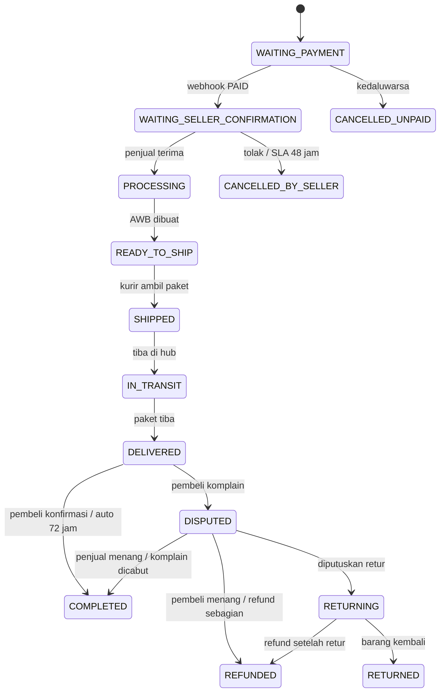
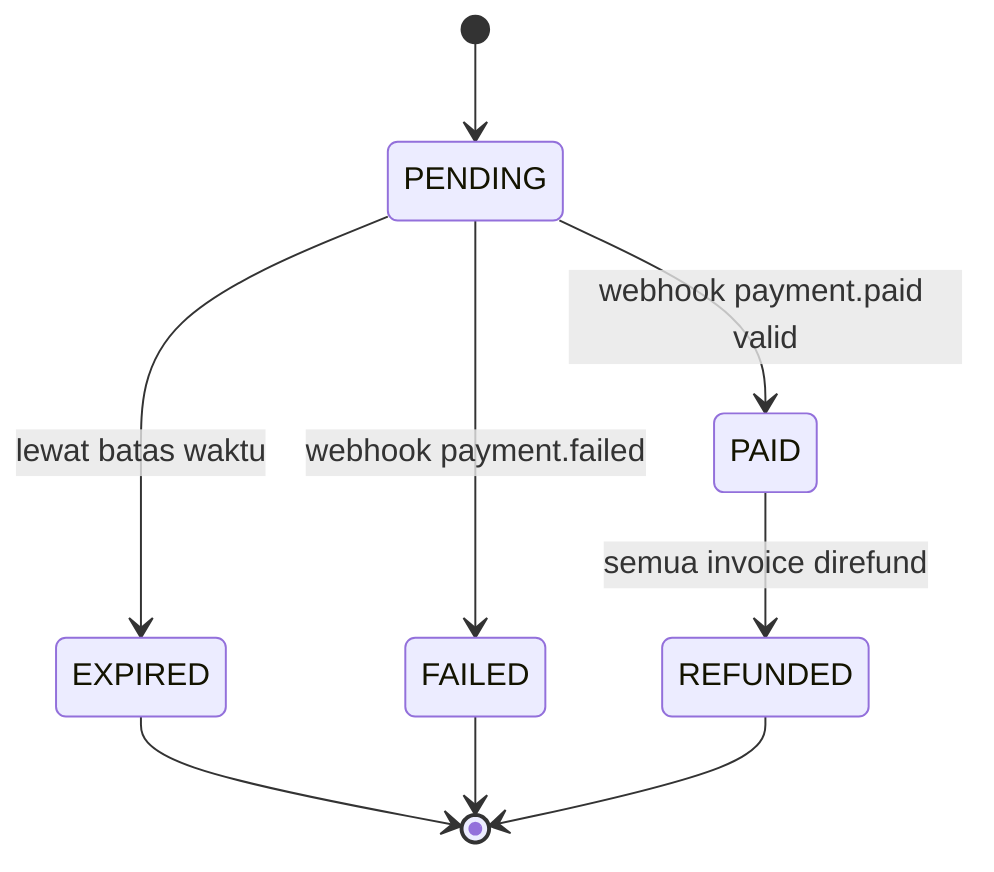
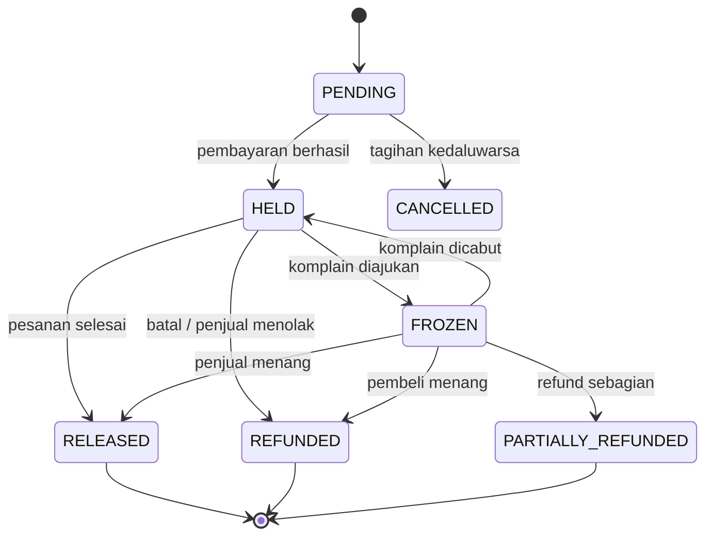

# State Machine Bakul

Status disimpan di database dan hanya berubah lewat layanan domain. Tabel di
bawah adalah sumber acuan untuk pengujian dan presentasi.

## 1. Pesanan (`order_invoices.order_status`)



Status final: `COMPLETED`, `REFUNDED`, `RETURNED`, `CANCELLED_UNPAID`,
`CANCELLED_BY_SELLER`.

## 2. Pembayaran (`payments.status`)



Batas waktu: VA 24 jam, QRIS 15 menit. Kedaluwarsa mengembalikan stok dan
membatalkan invoice.

## 3. Escrow (`order_invoices.escrow_status`)



Uang hanya berpindah saat status berubah dan jurnal ledger dibuat.

## 4. Pengiriman (`shipments.shipping_status`)

```text
AWB_CREATED -> PICKED_UP -> IN_TRANSIT -> ARRIVED_AT_DESTINATION
            -> OUT_FOR_DELIVERY -> DELIVERED
```

Timeline mock: +0 jam diambil, +3 jam hub asal, +14 jam transit, +26 jam tiba di
kota tujuan, +30 jam diantar, +32 jam diterima.

## 5. Komplain (`disputes.status`)

```text
WAITING_SELLER -> ESCALATED_TO_ADMIN -> RESOLVED_BUYER
                                     -> RESOLVED_SELLER
                                     -> RETURNING -> RESOLVED_BUYER
WAITING_SELLER -> CANCELLED_BY_BUYER
```

Aturan:

- Komplain hanya bisa diajukan saat invoice `DELIVERED` dan belum lewat 48 jam.
- Satu invoice hanya punya satu komplain.
- Komplain membekukan escrow dan menghentikan auto-complete.
- Penjual dapat langsung menyetujui refund.
- Admin dapat memutuskan dana ke penjual, refund penuh, refund sebagian, atau
  retur.

## 6. Pencairan (`withdrawals.status`)

```text
REQUESTED -> COMPLETED   (disetujui admin + jurnal keluar)
REQUESTED -> REJECTED    (saldo kembali ke dompet)
```

Minimum Rp50.000. Pengajuan mengunci saldo di `balance_withheld`; persetujuan
membuat jurnal `WITHDRAWAL` dan bukti transfer simulasi.

## 7. Penjaga transisi

| Lokasi | Penjaga |
| :--- | :--- |
| `checkout.service.ts` | stok, kurir, idempotensi, alamat |
| `payments.service.ts` | tanda tangan webhook, event unik, status PENDING |
| `order-lifecycle.service.ts` | SLA, auto-complete, refund, release, tracking |
| `seller-orders.service.ts` | kepemilikan invoice oleh penjual |
| `disputes.service.ts` | jendela 48 jam, satu dispute, peran peserta |
| `wallet.service.ts` | saldo cukup, minimum, idempotensi, status REQUESTED |

## 8. Uji yang menutup state machine

- `T-01` checkout multi-toko
- `T-02` anti-overselling
- `T-03` webhook idempoten
- `T-04` signature salah
- `T-05` kedaluwarsa mengembalikan stok
- `T-06` SLA penjual
- `T-07` auto-complete
- `T-08` komplain membekukan escrow
- `T-09` refund sebagian
- `T-10` tarik saldo melebihi saldo
- `T-11` ledger seimbang
- `T-12` akses lintas peran
- `T-14` bahasa antarmuka

Hasil terakhir ada di `docs/bukti/`.
